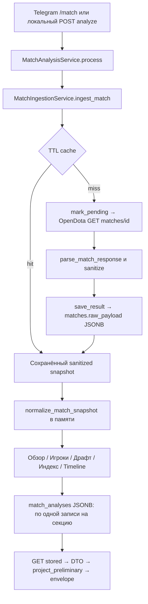

**RI-02-CAL-01-DATA / READY FOR QA.** Дата: 24.10.2026. HEAD `f222ee9dc322e98b8890ec642c9038244fe1e5a2`. Исследуется рабочее дерево с уже существующими незакоммиченными RI/PL/UI изменениями, а не чистый HEAD. Код, настройки, сохранённые матчи и прежние отчёты не изменены.

## Границы и источники

Изучены актуальный доступный `Downloads/Dota_Hub_Master_Plan_v0_1.md` (23.10.2026), RI-02-DIAG-01, RI-02-FIX-01, RI-04-FIX-01 и предыдущий CAL-01. Master Plan является планом: его прежние статусы не доказывают исправность. Он не изменялся.

Источник двух пилотов — PostgreSQL `matches.raw_payload` в транзакции `SET TRANSACTION READ ONLY`. Оба canonical SHA совпали с сохранёнными CAL-01 snapshots. Ещё десять матчей взяты из прежнего исследования, их наличие в рабочей БД не утверждается. Оригинальные HTTP bytes до sanitizer не сохранены: отсутствие account_id в этих snapshots нельзя объявлять отсутствием у OpenDota. Свежие матчи не запрашивались, `/request` не вызывался. Replay 120 игроков выполнен только в памяти.

## Функции и точки вызова

| Файл / функция | Вход | Выход | Преобразование / caller |
|---|---|---|---|
| [backend/app/bot/services.py:103](/Users/artemfedoseev/.codex/.chatgpt-projects/g-p-6ad91adda7e08191a8921416b367c275/dota-hub/backend/app/bot/services.py:103) `start_request` | Telegram update | service.process | команда после разрешений/лимитов |
| [backend/app/api/v1/local_alpha.py:40](/Users/artemfedoseev/.codex/.chatgpt-projects/g-p-6ad91adda7e08191a8921416b367c275/dota-hub/backend/app/api/v1/local_alpha.py:40) `analyze` | POST local ID | service.process | loopback-only; аудит POST не вызывает |
| [backend/app/services/match_analysis.py:181](/Users/artemfedoseev/.codex/.chatgpt-projects/g-p-6ad91adda7e08191a8921416b367c275/dota-hub/backend/app/services/match_analysis.py:181) `_process` | ID, previous flow | source_digest, normalized, reports | вызван process; writes queued/running before ingestion |
| [backend/app/services/match_ingestion.py:33](/Users/artemfedoseev/.codex/.chatgpt-projects/g-p-6ad91adda7e08191a8921416b367c275/dota-hub/backend/app/services/match_ingestion.py:33) `ingest_match` | ID | OpenDotaResult | process: per-ID lock, cache→pending→fetch→save |
| [backend/app/services/match_ingestion.py:44](/Users/artemfedoseev/.codex/.chatgpt-projects/g-p-6ad91adda7e08191a8921416b367c275/dota-hub/backend/app/services/match_ingestion.py:44) `_read_cache` | Match.raw_payload | result or None | TTL, timezone, player_public_data_version |
| [backend/app/services/match_ingestion.py:72](/Users/artemfedoseev/.codex/.chatgpt-projects/g-p-6ad91adda7e08191a8921416b367c275/dota-hub/backend/app/services/match_ingestion.py:72) `_mark_pending` | ID | pending raw placeholder | replaces previous raw via upsert_match |
| [backend/app/integrations/opendota.py:143](/Users/artemfedoseev/.codex/.chatgpt-projects/g-p-6ad91adda7e08191a8921416b367c275/dota-hub/backend/app/integrations/opendota.py:143) `get_json` | path | status/body/retry | bounded HTTP retries, JSON parsing |
| [backend/app/integrations/opendota.py:166](/Users/artemfedoseev/.codex/.chatgpt-projects/g-p-6ad91adda7e08191a8921416b367c275/dota-hub/backend/app/integrations/opendota.py:166) `fetch_match` | ID | OpenDotaResult | GET /matches/{id} |
| [backend/app/integrations/opendota.py:78](/Users/artemfedoseev/.codex/.chatgpt-projects/g-p-6ad91adda7e08191a8921416b367c275/dota-hub/backend/app/integrations/opendota.py:78) `parse_match_response` | HTTP object, time | snapshot | type/id/duration/core/arrays/team presence checks |
| [backend/app/integrations/opendota.py:58](/Users/artemfedoseev/.codex/.chatgpt-projects/g-p-6ad91adda7e08191a8921416b367c275/dota-hub/backend/app/integrations/opendota.py:58) `_sanitize` | match dict | deep copy | remove private player identifiers/chat; nickname whitespace/max80 |
| [backend/app/services/match_ingestion.py:87](/Users/artemfedoseev/.codex/.chatgpt-projects/g-p-6ad91adda7e08191a8921416b367c275/dota-hub/backend/app/services/match_ingestion.py:87) `_save_result` | result | JSONB snapshot/cache metadata | errors also replace raw |
| [backend/app/db/repositories.py:46](/Users/artemfedoseev/.codex/.chatgpt-projects/g-p-6ad91adda7e08191a8921416b367c275/dota-hub/backend/app/db/repositories.py:46) `upsert_match` | payload/status/time | Match | ON CONFLICT replace, no history |
| [backend/app/services/match_normalization.py:365](/Users/artemfedoseev/.codex/.chatgpt-projects/g-p-6ad91adda7e08191a8921416b367c275/dota-hub/backend/app/services/match_normalization.py:365) `normalize_match_snapshot` | sanitized snapshot | NormalizedMatch | summary/players/raw draft+events/derived, no DB normalized table |
| [backend/app/services/match_normalization.py:110](/Users/artemfedoseev/.codex/.chatgpt-projects/g-p-6ad91adda7e08191a8921416b367c275/dota-hub/backend/app/services/match_normalization.py:110) `_player` | one raw player | PlayerStat | rename, ranges, integers, finite stuns, estimated farm role |
| [backend/app/services/match_normalization.py:194](/Users/artemfedoseev/.codex/.chatgpt-projects/g-p-6ad91adda7e08191a8921416b367c275/dota-hub/backend/app/services/match_normalization.py:194) `_players` | players | sorted roster | unique slot 0..255, <=5 per side; does not require only standard slots |
| [backend/app/services/match_normalization.py:227](/Users/artemfedoseev/.codex/.chatgpt-projects/g-p-6ad91adda7e08191a8921416b367c275/dota-hub/backend/app/services/match_normalization.py:227) `_draft` | picks_bans | DraftRawData | source_order and source order kept; duplicates/gaps flagged |
| [backend/app/services/match_normalization.py:286](/Users/artemfedoseev/.codex/.chatgpt-projects/g-p-6ad91adda7e08191a8921416b367c275/dota-hub/backend/app/services/match_normalization.py:286) `_events` | event arrays | MatchEventRawData | deepcopy lists; only kills/buyback/purchase player logs mapped |
| [backend/app/services/match_normalization.py:343](/Users/artemfedoseev/.codex/.chatgpt-projects/g-p-6ad91adda7e08191a8921416b367c275/dota-hub/backend/app/services/match_normalization.py:343) `_derived` | players/scores | KDA and counter-ratio | round4, explicit missing/zero status |
| [backend/app/services/performance.py:32](/Users/artemfedoseev/.codex/.chatgpt-projects/g-p-6ad91adda7e08191a8921416b367c275/dota-hub/backend/app/services/performance.py:32) `participation_assessment` | player/match/config | usable,raw,reason | counter arithmetic separate from suitability |
| [backend/app/services/performance.py:61](/Users/artemfedoseev/.codex/.chatgpt-projects/g-p-6ad91adda7e08191a8921416b367c275/dota-hub/backend/app/services/performance.py:61) `observed` | PlayerStat | metrics | per-minute rates; original GPM/XPM; null preserved |
| [backend/app/services/performance.py:102](/Users/artemfedoseev/.codex/.chatgpt-projects/g-p-6ad91adda7e08191a8921416b367c275/dota-hub/backend/app/services/performance.py:102) `evaluate` | NormalizedMatch | RuinerReport | cohorts→compare→axes→credit→coverage→index→selection |
| [backend/app/services/performance.py:161](/Users/artemfedoseev/.codex/.chatgpt-projects/g-p-6ad91adda7e08191a8921416b367c275/dota-hub/backend/app/services/performance.py:161) `compare` | one observation/peer observations | bad or credit-only good | nested evaluate function; median excluding self, floors/clamp |
| [backend/app/services/performance.py:81](/Users/artemfedoseev/.codex/.chatgpt-projects/g-p-6ad91adda7e08191a8921416b367c275/dota-hub/backend/app/services/performance.py:81) `select_team` | five reports | strict selection | all medium/full coverage + threshold/margin/signals |
| [backend/app/services/performance_preliminary.py:15](/Users/artemfedoseev/.codex/.chatgpt-projects/g-p-6ad91adda7e08191a8921416b367c275/dota-hub/backend/app/services/performance_preliminary.py:15) `select_preliminary` | same-team reports, optional leaver context | preliminary projection | production caller does not supply leaver context |
| [backend/app/services/match_analysis.py:60](/Users/artemfedoseev/.codex/.chatgpt-projects/g-p-6ad91adda7e08191a8921416b367c275/dota-hub/backend/app/services/match_analysis.py:60) `public_base` | normalized | OverviewReport/PlayersReport | catalog metadata/item details; selective public fields |
| [backend/app/services/timeline.py:130](/Users/artemfedoseev/.codex/.chatgpt-projects/g-p-6ad91adda7e08191a8921416b367c275/dota-hub/backend/app/services/timeline.py:130) `analyze_timeline` | normalized.raw.events | TimelineReport | times, event dedupe, provenance, coverage |
| [backend/app/services/match_analysis.py:56](/Users/artemfedoseev/.codex/.chatgpt-projects/g-p-6ad91adda7e08191a8921416b367c275/dota-hub/backend/app/services/match_analysis.py:56) `digest` | snapshot subset/config | SHA256 | sorted JSON no NaN; no implementation-code digest |
| [backend/app/db/repositories.py:66](/Users/artemfedoseev/.codex/.chatgpt-projects/g-p-6ad91adda7e08191a8921416b367c275/dota-hub/backend/app/db/repositories.py:66) `save_analysis` | report wrapper | MatchAnalysis | upsert unique match/version; source/config metadata |
| [backend/app/api/v1/matches.py:57](/Users/artemfedoseev/.codex/.chatgpt-projects/g-p-6ad91adda7e08191a8921416b367c275/dota-hub/backend/app/api/v1/matches.py:57) `stored` | ID/section/session | JSONResponse | source digest vs flow, DTO validation, no refetch/reanalysis |
| [backend/app/services/performance_preliminary.py:78](/Users/artemfedoseev/.codex/.chatgpt-projects/g-p-6ad91adda7e08191a8921416b367c275/dota-hub/backend/app/services/performance_preliminary.py:78) `project_preliminary` | persisted RuinerReport | read-time projection | legacy computed; inconsistent semantic choice -> none; DB untouched |
| [backend/app/api/v1/matches.py:50](/Users/artemfedoseev/.codex/.chatgpt-projects/g-p-6ad91adda7e08191a8921416b367c275/dota-hub/backend/app/api/v1/matches.py:50) `response` | envelope/status | JSON | Cache-Control no-store; retry header |
| [backend/app/api/v1/auth.py:69](/Users/artemfedoseev/.codex/.chatgpt-projects/g-p-6ad91adda7e08191a8921416b367c275/dota-hub/backend/app/api/v1/auth.py:69) `current_user` | session token→existing user | authorized user | Telegram JWT validation + DB lookup; no per-match ownership filter |
| [backend/app/api/v1/local_alpha.py:51](/Users/artemfedoseev/.codex/.chatgpt-projects/g-p-6ad91adda7e08191a8921416b367c275/dota-hub/backend/app/api/v1/local_alpha.py:51) `section` | loopback GET | stored(...) | same public section DTOs; generic local OpenAPI response |

## HTTP и хранение

Runtime OpenDota endpoints: `GET /api/matches/{match_id}`; дополнительно `GET /api/heroes/{hero_id}/matchups` для Draft. RI не получает benchmark, proMatches, players/history, POST parse. Предыдущий автономный CAL-01 обращался к `/publicMatches` и `/benchmarks?hero_id=...`; это исследовательский скрипт, не pipeline RI. Справочники героев/предметов/режимов/патчей читаются из закреплённых локальных JSON через player_catalog. API key опционален, передаётся Authorization, в логах/отчётах отсутствует.

Match HTTP timeout по умолчанию 15s, max_retries=2 (всего до3 попыток), backoff .25s exponential при network/5xx; 404/429 не повторяются автоматически. Retry-After поддерживает только целые секунды 1..3600, не HTTP-date. Match cache success3600s/notfound300s/error60s, rate-limit TTL=Retry-After. TTL — срок повторного получения данных, не гарантия свежести анализа. Per-match single-flight ограничен процессом; между worker и web экземплярами общего lock нет. Matchup cache в памяти, отдельный общий для героев cooldown429. В процессе аудита внешних игровых запросов не было.

Live схема проверена через information_schema (capture.json). `matches`: BIGINT PK match_id; fetch_status varchar с CHECK; raw_payload JSONB nullable; fetched_at/created_at/updated_at timestamptz. `match_analyses`: UUID PK; BIGINT FK match_id RESTRICT; algorithm_version varchar64; JSONB report_payload; status/completeness CHECK; computed_at timestamptz; UNIQUE(match_id,algorithm_version). Секции имеют ключи `group_flow_v1:overview|players|draft|ruiner|timeline`, flow — `group_flow_v1`. Значение `ruiner_v1` находится внутри report, а не является SQL ключом секции. Для нормализованных игроков отдельной таблицы нет. Live определения constraints/indexes сохранены в db_verification.json. DTO: backend/app/models/matches.py (PlayerStat, NormalizedMatch, DerivedMetric), models/performance.py (PlayerPerformance, TeamPerformanceReport, RuinerReport), models/match_api.py (MatchEnvelope, PublicPlayer, OverviewReport). История snapshot/report не ведётся. Фактические колонки сохранены в capture.json, ограничения и операции подтверждены db/models.py, migrations и существующими PostgreSQL-тестами.

Sanitized raw сохраняется целиком в JSONB до нормализации, включая неизвестные поля. NormalizedMatch.raw содержит **только** DraftRawData и MatchEventRawData, не весь исходный snapshot. Поэтому NOT_MAPPED означает, что поле осталось в raw БД, но отсутствует в typed pipeline. LOST_IN_BACKEND для leaver означает утрату по пути к решению, а не исчезновение из JSONB. account_id и chat удаляются раньше: намеренная политика приватности. Отсутствие персонального поля в публичном DTO не дефект.

Source digest связывает report с flow, но GET не сверяет текущий Match.raw_payload и не проверяет согласованность model/config версии оболочки с data. source_digest учитывает match/status/schema_version, не время fetch. config digest учитывает значения настроек, не код: старый report и новый replay могут иметь тот же ruiner_v1/digest. Сохранённый report после обновления кода не становится автоматически новым.

## P1: события, draft и публичные поля

Overview сохраняет базовые score/winner/mode/patch/rosters; towers_destroyed/roshan_kills остаются null с объяснением. Players передаёт K/D/A, GPM/XPM, damage/healing/net_worth, obs_placed/sen_placed, items/backpack/neutral, level, stuns, buyback_count, позиции; observer_kills/sentry_kills есть в RI metrics, но нет в PublicPlayer. account/Steam IDs намеренно не выдаются. Нули item IDs означают empty, null — отсутствие данных, неизвестный catalog ID — unmapped.

Draft сохраняет явные hero_id/team/is_pick/order и исходный индекс, не восстанавливает порядок по slots. draft_timings остаётся в raw и не используется. Режим/патч ограничивают достоверность; aggregate matchups не доказывают статистику конкретного патча.

Timeline использует objectives, teamfights, radiant_gold_adv/xp_adv, общие и player kills/buyback/purchase logs. Секунды [-3600,duration+60] сохраняют pregame; графики индексируются minute*60. Slots игроков 0..4/128..132, `slot` событий может означать индекс 0..9 — требуется различать пространства. Dedupe сохраняет original_refs; purchase добавляет source ref в ключ, чтобы не слить две покупки одного предмета в секунду. Кривая отрицательна для преимущества Dire, не отбрасывается как невалидная статистика. game_mode/patch/picks не влияют на RI через Timeline.

Серии gold_t/xp_t/lh_t, deaths_log, connection_log, ward logs/maps, lane_pos, hero_damage_t/healing_t, ability/item usage/targets/upgrades, neutral_item_history остаются только в raw (если присутствуют). Их наличие само по себе не разрешает придумывать новую аналитику. P2 инвентаризирован автоматически по всем прочим фактическим match/player ключам. Большие массивы в CSV представлены длиной, SHA, sample и точным путём к сохранённому полному значению.

## Проверенные внешние первоисточники

- [core 86e09304d7775540fd5e22e9a94d930034c4da09](https://github.com/odota/core/blob/86e09304d7775540fd5e22e9a94d930034c4da09/sql/create_tables.sql), прочитан 2026-10-24T08:21:11.178565+00:00, SHA bytes `60d75da61637bec6f6ef05f421e601ae6b51ff8b713ee9d383c663ee793d8894`.
- [parser 927adf6bbd1fd321b711f544a5d754bfe75d89a7](https://github.com/odota/parser/blob/927adf6bbd1fd321b711f544a5d754bfe75d89a7/src/main/java/opendota/Parse.java), прочитан 2026-10-24T08:21:11.892818+00:00, SHA bytes `6e59dfff2f2eed48f225a653372f7acdd151179ef8d984777bfcdea60223e61c`.
- [dotaconstants 5c0242df9057848fa2036ca3fafe9f2bd4508163](https://github.com/odota/dotaconstants/blob/5c0242df9057848fa2036ca3fafe9f2bd4508163/build/game_mode.json), прочитан 2026-10-24T08:21:12.743794+00:00, SHA bytes `fc54b48fc37c0d8989d0b71c5b438524adcc0eaf7e521690e5152dd37f6f4cf4`.

[Документация OpenDota](https://docs.opendota.com/) проверена 24.10.2026, страница динамическая и не дала читаемую схему через web extraction. Не использовалась как доказательство обязательности каждого поля. Схема core разделяет match и player counters, хранит stuns как real, GPM/XPM как integer, отдельно leaver_status и parsed fields. Parser получает teamfight_participation из игрового свойства отдельно от K/D/A. Это не доказывает, что 1.2 является долей уникальных убийств. Семантика конкретного спорного assist остаётся UNVERIFIED. dotaconstants проверен как источник режима, но runtime использует локальную закреплённую ревизию, а не скачанный master.

[Воспроизводимые свидетельства](qa/ri02/data01/) · [Матрица](RI_02_DATA_01_FIELD_MATRIX.csv) · [QA](RI_02_DATA_01_QA_REPORT.md)
